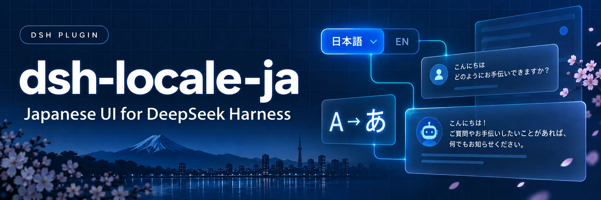

<p align="center">
  
</p>

# dsh-locale-ja

[English](README.md) | [日本語](README.ja.md)

DeepSeek Harness（DSH）の Web UI に日本語を追加するプラグインです。

## 機能

- DSH の Web UI を日本語化します。
- ユーザーのフォント設定を優先しつつ、日本語向けの代替フォントを使います。
- UI で日本語を明示的に選ぶと、AI に日本語での応答を指示します。別の言語を指定することもできます。

## 対応バージョン

DSH の Web UI で使います。[GitHub Releases](https://github.com/so16tm/dsh-locale-ja/releases) から対応するタグを選んでください。対応 DSH と変更点は各リリースと [CHANGELOG.md](CHANGELOG.md) に記録しています。

## インストール

Git と、この非公開リポジトリへのアクセス権がある GitHub アカウントの認証設定が必要です。`<tag>` は選んだリリースのタグ名に置き換えてください。ビルド済みファイルを含むため、手元でのビルドは不要です。

```sh
dsh plugin --profile web add 'git+https://github.com/so16tm/dsh-locale-ja.git#<tag>'
dsh web
```

この例では `web` プロファイルを使います。タグを省略すると、未リリースの変更を含む場合がある `main` が入ります。

更新するときは、削除せずに新しい版のタグで同じ `add` コマンドを実行し、`dsh web` を再起動してください。入っている版が新しい版に置き換わります。

削除するときは次を実行します。

```sh
dsh plugin --profile web remove @so16tm/dsh-locale-ja
```

削除後も DSH を再起動してください。

## 使い方

**Settings → General → Language** で **日本語** を選びます。応答言語の指示は次の応答から反映されます。

この指示には、日本語を明示的に選び、その選択が DSH ホストに保存されている必要があります。ブラウザーの自動選択や、LAN 内の別 PC からのアクセスなどホストに選択を保存できない場合は加わりません。ユーザーが別の応答言語を明示した場合は、その指定を優先します。

## 設定

応答言語の指示が不要な場合は、プロファイルの `cordis.patch.yml` に次を追加すると無効になります。

```yaml
- id: so16tm-locale-ja
  config:
    replyInUiLanguage: false
```

## 制限事項

- 他の日本語化プラグインを使っている場合は、先に削除してください。
- DSH に新しく増えた文字列は、訳の追加まで英語で表示される場合があります。

## 開発

```sh
pnpm install --frozen-lockfile
pnpm check
```

`pnpm check` は型チェック、ビルド、テスト、翻訳率の確認、リリースノートの検証を実行します。

翻訳を編集するときは [翻訳ガイド](docs/translation-guide.md) に従ってください。原文の取得・翻訳の取り込み・互換性確認・リリースの手順は [DSH 更新手順](.claude/skills/dsh-update/SKILL.md)、設計上の制約は [ARCHITECTURE.md](ARCHITECTURE.md) にまとめています。

ソースや訳を変更したら、生成された `lib/` も一緒にコミットします。使い方が変わったときは両言語の README を更新し、版ごとの情報は CHANGELOG.md に記録してください。

## ライセンス

[MIT](LICENSE)。参考にしたプロジェクトは [THIRD_PARTY_NOTICES.md](THIRD_PARTY_NOTICES.md) に記載しています。
